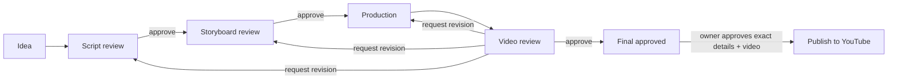

# Oddly Relatable Studio

A dashboard-driven production studio for the Oddly Relatable channel. From one dashboard the owner can:
1. submit an idea;
2. get an original script, then edit and approve it;
3. review the storyboard, with renderer stills for each scene;
4. run production through the existing engine and monitor every job;
5. review the video, request targeted revisions and approve the final cut;
6. approve publication, after which the video is uploaded to YouTube.

The engine (`production/`) and the renderer (`skills/directing-stickman-videos/`) are used exactly as their CLIs document and are not modified. `studio/` (the earlier local MVP) is untouched.

| Part | Path | Technology |
|---|---|---|
| API | `api/oddstudio/` | FastAPI, SQLAlchemy 2, Alembic (PostgreSQL in deployment) |
| Worker | `api/oddstudio/worker.py`, `tasks.py` | Python; jobs in PostgreSQL, dispatched through Redis |
| Dashboard | `web/` | Next.js 16 (App Router), no UI framework |
| Deployment | `deploy/docker-compose.yml` | Postgres 16, Redis 7, api, worker, web; ports on 127.0.0.1 only |

**Documents:**
- [`docs/VOICE-AND-CASTING.md`](docs/VOICE-AND-CASTING.md): story-driven characters, voices, credentials and running costs;
- [`docs/DEPLOYMENT.md`](docs/DEPLOYMENT.md): `/srv/stickman` deployment, backups, rollback;
- [`docs/SECURITY-REVIEW.md`](docs/SECURITY-REVIEW.md);
- [`docs/LONG-FORM-PLAN.md`](docs/LONG-FORM-PLAN.md): 5–7 minute episodes (plan only).

**No fixed cast.** Each script may introduce the characters its story needs. Their pose and expression sheets are generated on the owner's request and shown for approval. Approved characters can join the recurring cast for later stories.

## Workflow and approval gates



- **Enforced on the server.** Every state-changing route calls `workflow.require()`, so an action outside its stage gets 409. The dashboard only hides buttons; the API is what refuses.
- **Script edits:** each edit is validated (`script_schema.py`) and saved as a new version. Approval records the exact version.
- **Storyboard approval** needs every scene that was marked for revision to be edited first.
- **Start production is refused** while any character has no approved pose art, or if the script is longer than the production limit (60 s by default).
- **Revisions bump the episode revision.**
  - `script` reopens script review.
  - `storyboard` reopens storyboard review, with the chosen scenes marked.
  - `scenes` re-produces only the chosen scenes, then re-renders.
- **Publishing needs all of the following:**
  - final video approval;
  - publish details saved, then approved by typing `PUBLISH`, which binds the approval to the current revision and video. Editing any detail withdraws the approval;
  - YouTube credentials on the server.

  The upload job checks the approval again when it runs.
- **Audit trail:** every decision is appended to `reviews`; activity goes to `events`.

## Production pipeline (worker)

| Job | What it does |
|---|---|
| `generate_script`, `regenerate_section`, `regenerate_scene` | AI writer (configured provider) → validated script/scene |
| `generate_storyboard` | Scene breakdown from the approved script version; queues `scene_reference` per scene |
| `scene_reference`, `scene_prepare` | Engine `build` + `storyboard` for one scene: validates it and stores renderer-exact stills |
| `scene_voice` | One clip per line in the character's assigned voice, with acting direction (voice style, expression, delivery); reported as **skipped** when no voice provider is set (SFX only) |
| `character_sheet` | A character's pose and expression sheet: neutral first, the rest drawn from it; cut-out, measured, labelled sheet for owner approval |
| `voice_preview` | A short sample of a character's voice |
| `render_episode` | Engine `produce`: audio bed (voice clips placed at the engine's line timings), MP4, QA, reports, manifest |
| `character_pose` | One expression pose image via the image provider; analysed for feet and figure height; awaits owner approval |
| `publish_youtube` | Resumable upload to YouTube with the approved details |

- **Failures:** a failed job keeps its error and log. **Retry** re-runs only that job. When the last scene job succeeds, the render is queued.
- **Restarts:** a worker restart marks interrupted jobs as failed (retryable) and re-announces queued jobs, so nothing is lost.

## What needs credentials or other infrastructure

Nothing below is faked. Without the dependency, the step fails with a clear "Not configured" message.

| Capability | Needs | Cost |
|---|---|---|
| AI script writing | `codex-cli` (the Codex CLI in the API/worker image, signed in with ChatGPT: see below), or `OPENAI_API_KEY`, or `ANTHROPIC_API_KEY` | Codex: ChatGPT subscription. APIs: a few cents per script |
| Character pose images, sets, storyboard frames | `codex-cli` (ChatGPT plan, see below), or `OPENAI_API_KEY` (Images API) | Codex: $0 per image (plan allowance). OpenAI: per image |
| Voices | `OPENAI_API_KEY` (gpt-4o-mini-tts), `ELEVENLABS_API_KEY`, or Piper installed on the worker (free); otherwise videos carry the engine's SFX only | About $0.01 per Short with OpenAI (see docs/VOICE-AND-CASTING.md) |
| S3 media | `STORAGE_BACKEND=s3`, `S3_BUCKET`, an instance role or `AWS_*` keys | Storage and egress |
| YouTube publishing | `YOUTUBE_CLIENT_ID`, `YOUTUBE_CLIENT_SECRET`, `YOUTUBE_REFRESH_TOKEN` (scope `youtube.upload`) | API quota only |
| GPU | Not needed: rendering is CPU (Node + FFmpeg) | — |

**Budget:** within the $150/month target.
- The current server, Postgres, Redis and local storage add $0.
- The optional AI APIs are pay-per-use, with cents per episode at Shorts length.
- Codex adds no spending.

### Codex on the ChatGPT plan

The API and worker images include the Codex CLI. Signed in with the owner's ChatGPT account, Settings > AI providers
offers **Codex (ChatGPT plan)** for images (and text) at **$0 per call**: it uses the plan allowance, not API credits.

- **Sign in once** (device code; first enable "device code login" in ChatGPT > Settings > Security):
  `docker exec -it -u studio oddstudio-worker-1 codex login --device-auth`, then open the link it shows and enter the
  code. The login is saved in `CODEX_HOME=/data/codex` on the shared data volume, so the API and worker both use it
  and it survives redeploys. Check with `docker exec -u studio oddstudio-worker-1 codex login status`
  ("Logged in using ChatGPT").
- **The login file is a password.** `/data/codex/auth.json` holds access tokens: never copy it into the repository,
  logs, chat or backups that leave the server. Sign out with `codex logout` in the same container.
- **Safeguards in the code:** OpenAI API keys are removed from Codex's environment, so it can never bill the API; an
  API-key sign-in is refused; a Codex failure never falls back to a paid provider and is never retried automatically;
  when the plan limit is reached the job stops with Codex's message and can be retried later by the owner.
- Each image takes about 1-2 minutes. Images Codex makes but fails to copy out are collected from its own images folder
  (only ones made by that call).

**New characters** need pose art. Until their poses are generated and approved under Characters, production refuses scripts that put them on screen. Character 01 uses the approved repository artwork and is locked.

## Run locally (development)

```bash
# API and worker (SQLite and no Redis are fine for development: the worker then polls the database)
cd studio-app/api
pip install -r requirements.txt
export DATABASE_URL=sqlite:///./studio-dev.db OWNER_EMAIL=you@example.com \
       OWNER_PASSWORD_HASH="$(python -m oddstudio.auth hash)" SESSION_SECRET=$(python -c "import secrets;print(secrets.token_hex(32))") \
       COOKIE_SECURE=false FFMPEG=/path/to/ffmpeg FFPROBE=/path/to/ffprobe
alembic upgrade head
uvicorn oddstudio.main:app --port 8000 &
python -m oddstudio.worker &
# Dashboard
cd ../web && npm ci && npm run build && npm start      # http://127.0.0.1:3000
```

## Deploy (Docker Compose)

```bash
cd studio-app/deploy
cp .env.example .env        # fill in; .env is git-ignored
docker compose up -d --build
docker compose logs -f api worker
```

- The API container runs `alembic upgrade head` on start.
- Only the dashboard has a host port, bound to `127.0.0.1`. The full procedure, with release layout, backups and rollback, is in `docs/DEPLOYMENT.md`. Use the dashboard through an SSH tunnel: `ssh -L 3000:127.0.0.1:3000 <admin>@<server>`.
- **Before exposing it publicly:**
  - add a domain and a TLS reverse proxy, and set `COOKIE_SECURE=true`;
  - finish the server hardening in `docs/VPS_PRODUCTION_READINESS.md`: key-only SSH and no root password login.

## YouTube setup

1. In Google Cloud, create a project and enable the YouTube Data API v3. Create an OAuth client of type "Desktop app".
2. Authorise once with the channel's account for the scope `https://www.googleapis.com/auth/youtube.upload`, and keep the refresh token. The OAuth Playground or a short local script both work.
3. Put the client ID, secret and refresh token in `deploy/.env`.

Videos upload as **private** by default, so they can be checked on YouTube before going public.

## Security

- **Sign-in:** a single owner account.
  - The password is stored only as a PBKDF2-SHA256 hash, from `OWNER_PASSWORD_HASH`.
  - The session is an HMAC-signed, httpOnly, `SameSite=Strict` cookie, and failed sign-ins are rate-limited.
- **Secrets** exist only in the server environment. `/api/settings` reports whether each is configured, never its value, and the dashboard never receives them.
- **Media:**
  - S3 objects are served through presigned URLs.
  - Local files use HMAC-signed, expiring URLs, with keys validated against path traversal.
  - Uploads must be PNG or JPEG and are verified with Pillow.
- **Subprocesses** (Node engine, Codex) are called with argument lists, never a shell.
- **The containers** run as non-root users, and every port is bound to localhost.

## Tests

```bash
cd studio-app/api/tests
python -m unittest -v      # all suites; renderer-backed tests skip without FFMPEG/FFPROBE
#   test_workflow        gates, auth, settings, media signing (seconds)
#   test_cast_and_voice  story-introduced characters, sheets, approval, reuse, voice assignment/preview, and a real
#                        render with a generated character and voiced, synchronised dialogue (~1.5 min)
#   test_end_to_end      full sample episode through the real engine (~2 min)
cd ../../web && npx tsc --noEmit && npx next build
```

The end-to-end test's script comes from a test-only writer stand-in, which is refused unless `ODD_ENV=test`. Everything after the script (stills, MP4, QA, revision, gates) is real engine work.
