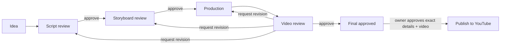

# Oddly Relatable Studio

A dashboard-driven production studio for the Oddly Relatable channel. From one dashboard the owner can:
1. submit an idea;
2. get an original script, then edit and approve it;
3. review the storyboard, with renderer stills for each scene;
4. run production through the existing engine and monitor every job;
5. review the video, request targeted revisions and approve the final cut;
6. approve publication, after which the video is uploaded to YouTube.

The engine (`production/`) and the renderer (`skills/directing-stickman-videos/`) are used exactly as their CLIs document and are not modified. `studio/` (the earlier local MVP) is untouched.

| Part | Path | Technology |
|---|---|---|
| API | `api/oddstudio/` | FastAPI, SQLAlchemy 2, Alembic (PostgreSQL in deployment) |
| Worker | `api/oddstudio/worker.py`, `tasks.py` | Python; jobs in PostgreSQL, dispatched through Redis |
| Dashboard | `web/` | Next.js 16 (App Router), no UI framework |
| Deployment | `deploy/docker-compose.yml` | Postgres 16, Redis 7, api, worker, web; ports on 127.0.0.1 only |

**Documents:**
- [`docs/VOICE-AND-CASTING.md`](docs/VOICE-AND-CASTING.md): story-driven characters, voices, credentials and running costs;
- [`docs/DEPLOYMENT.md`](docs/DEPLOYMENT.md): `/srv/stickman` deployment, backups, rollback;
- [`docs/SECURITY-REVIEW.md`](docs/SECURITY-REVIEW.md);
- [`docs/LONG-FORM-PLAN.md`](docs/LONG-FORM-PLAN.md): 5–7 minute episodes (plan only).

**No fixed cast.** Each script may introduce the characters its story needs. Their pose and expression sheets are generated on the owner's request and shown for approval. Approved characters can join the recurring cast for later stories.

## The dashboard

The menu has four places: **Episodes**, **Characters**, **Chat** (a placeholder for now) and **Settings**. Every other page (Overview, Ideas, Scripts, Storyboards, Production, Lab, Video Library, Publishing, Bin) keeps its address and is listed under **Settings › Advanced**.

- **Episodes** (`/`): a new episode from a dropped video (title, format: YouTube long 16:9 or Short 9:16, the recording's rights), then one line per episode with what it waits for.
- **An episode** (`/episodes/{id}`): six one-line steps (Video, Characters, Sets, Storyboard, Video, Final). Finished steps stay folded; a step that needs the owner opens. Notes, jobs and logs sit behind a closed "details". The full workspace is the **Advanced view** (`/episodes/{id}/advanced`); `?open=<section>` opens one of its sections.
- **Generate** (`web/lib/dashboard.ts`, `generatePlan`) runs only free steps by itself: building an audio episode's scenes when the writer's estimate (`GET /api/episodes/{id}/audio/scenes/estimate`) is exactly $0, and generating the storyboard from an approved script. It stops at every owner decision and at every paid step; paid steps show their cost and have their own button. It never approves anything.

## Workflow and approval gates



- **Enforced on the server.** Every state-changing route calls `workflow.require()`, so an action outside its stage gets 409. The dashboard only hides buttons; the API is what refuses.
- **Script edits:** each edit is validated (`script_schema.py`) and saved as a new version. Approval records the exact version.
- **Storyboard approval** needs every scene that was marked for revision to be edited first.
- **Start production is refused** while any character has no approved pose art, or if the script is longer than the production limit (60 s by default).
- **Revisions bump the episode revision.**
  - `script` reopens script review.
  - `storyboard` reopens storyboard review, with the chosen scenes marked.
  - `scenes` re-produces only the chosen scenes, then re-renders.
- **Publishing needs all of the following:**
  - final video approval;
  - publish details saved, then approved by typing `PUBLISH`, which binds the approval to the current revision and video. Editing any detail withdraws the approval;
  - YouTube credentials on the server.

  The upload job checks the approval again when it runs.
- **Audit trail:** every decision is appended to `reviews`; activity goes to `events`.

## Production pipeline (worker)

| Job | What it does |
|---|---|
| `generate_script`, `regenerate_section`, `regenerate_scene` | AI writer (configured provider) → validated script/scene |
| `generate_storyboard` | Scene breakdown from the approved script version; queues `scene_reference` per scene |
| `scene_reference`, `scene_prepare` | Engine `build` + `storyboard` for one scene: validates it and stores renderer-exact stills |
| `scene_voice` | One clip per line in the character's assigned voice, with acting direction (voice style, expression, delivery); reported as **skipped** when no voice provider is set (SFX only) |
| `character_sheet` | A character's pose and expression sheet: neutral first, the rest drawn from it; cut-out, measured, labelled sheet for owner approval |
| `voice_preview` | A short sample of a character's voice |
| `render_episode` | Engine `produce`: audio bed (voice clips placed at the engine's line timings), MP4, QA, reports, manifest |
| `character_pose` | One expression pose image via the image provider; analysed for feet and figure height; awaits owner approval |
| `publish_youtube` | Resumable upload to YouTube with the approved details |

- **Failures:** a failed job keeps its error and log. **Retry** re-runs only that job. When the last scene job succeeds, the render is queued.
- **Restarts:** a worker restart marks interrupted jobs as failed (retryable) and re-announces queued jobs, so nothing is lost.

## Stick pipeline (hosted images and video) and the chat

Owner decision 2026-11-25. Code: `api/oddstudio/stick_pipeline.py`, `stick_shots.py`, `chat.py`; settings under
Settings > Studio style and Settings > Chat.

| Step | Job | Provider and price | References |
|---|---|---|---|
| Character master | `stick_master` | WaveSpeed `google/nano-banana-2.1/edit`, $0.04 per image x candidates (default 2) | the studio style prompt + the character's look; the owner's style reference image |
| Expressions / turnaround sheet | `stick_sheet` | same, one image ($0.04) | the approved master ONLY |
| Shot still | `stick_shot_still` | same, one image ($0.04) | the shot's set, then the approved master of each character in the shot |
| Animate an approved shot | `stick_shot_animate` | WaveSpeed `wavespeed-ai/wan-2.2/i2v-720p`, **$0.06 per second of video** (5 s = $0.30, 8 s = $0.48) | the approved still |

- **Cost first:** every paid button shows its price (`count x price per image`, or `seconds x price per second`) and asks
  before it starts; the request carries that price (`confirm_usd`) and the API refuses any other amount. Animate all
  approved shows the total (clips x seconds x price per second). WaveSpeed's model list gives a video model's
  `base_price` per second, an image model's per image.
- **Never retried:** a submit is one paid call; failures are not retried by the worker. Spend counts against the
  experimental budget (Settings > Motion).
- **No approvals by code:** candidates, sheets, stills and clips go to review; only the owner's clicks approve them.
  A still is a new take of the storyboard shot (older takes kept); clips are kept per shot as versions.
- **Seams:** a self-hosted GPU video provider (`gpu-self-hosted`, not connected yet) and talking shots
  (`wavespeed-ai/infinitetalk-fast`, see `shot_compare.py`) are TODOs.
- **Chat:** Anthropic (`claude-opus-5-5`, $4 / $20 per million input / output tokens) when `anthropic_api_key` is saved,
  else OpenAI (`gpt-4.1-mini`). Read-only context: episodes, characters, recent jobs, non-secret settings. Each message
  shows its estimate before sending and its real usage after; conversations are stored as `_chat:<id>` settings rows.
  Keys only come from the credential store and are never logged or returned.

## Guided generation

Page: `/episodes/<id>/guide` (linked as "Guided steps" from the episode page). Code: `api/oddstudio/guided.py`,
`acting_analysis.py`, `prompt_writer.py`; web `app/(studio)/episodes/[id]/guide/page.tsx`, `lib/guide.ts`. Settings
under Settings > Guided generation.

One list of eleven steps, each with what it does, why, what it needs, its live cost and its status (not started,
running, needs your approval, done), and a Help panel that walks through one instruction at a time:

| # | Step | In the dashboard |
|---|---|---|
| 1 | Upload: script, voice recording, reference video | yes (the reference video is kept under `private/`, never in the asset list) |
| 2 | Acting analysis (Gemini) | yes: job `acting_analysis` |
| 3 | Prompt writing (OpenAI) | yes: every generation prompt is written first, then edited and approved by the owner |
| 4 | Cast (characters from the video, five styles, masters) | yes: jobs `cast_describe`, `cast_images` (see "Cast from video") |
| 5 | Sets and seating masters | links to the storyboard stills; each wall is drawn straight-on (the image model cannot rotate a room) |
| 6-11 | Close-ups, faces, movement, talking shots, quality check, assembly | help text only, "Not in the dashboard yet" |

- **Acting analysis:** the reference video is uploaded once to the Gemini Files API (resumable), read in up to 3
  batches of shots (`video_metadata` fps 5 with the batch's start and end offsets; JSON output, temperature 0.4, 30,000
  output tokens, thinking level low) and deleted from Google afterwards, also on failure. Shots come from the
  storyboard, or even 4 s slices of the video. Answers that come back as a bare list, or a list wrapping the object,
  are normalised. Default model `gemini-3.1-pro-preview` (paid tier); the free-tier models are tried on 429/503 only
  when the owner ticks it for that run (the free tier may train on uploads). Key frames are cut with FFmpeg into
  private storage and shown as "Reference — private, never sent to an image or video generator". Stored as the
  `acting:<episode>` settings row.
- **Prompt writer:** official `openai` SDK (Responses API), default model `gpt-5.5`, one call, never retried. Input:
  the kind (master, still, face edit, movement), the owner's notes, the chosen shot's acting beats, the character's
  approved description and the studio style text. Drafts are stored as `prompts:<episode>`; an edit after approval
  makes the prompt a draft again. An empty OpenAI balance is reported as "Your OpenAI balance is empty; add credit at
  platform.openai.com > Billing".
- **Cost first:** both paid actions show an estimate (typical and maximum) and the request must carry the maximum
  (`confirm_usd`); any other amount is refused with HTTP 409 and nothing is sent. Real token usage and cost are
  recorded after each call. Prices per million tokens are editable in Settings (defaults: Gemini $2 in / $12 out,
  about 300 tokens per second of video; OpenAI $5 in / $30 out, check the current price list).
- Keys come only from the credential store (`gemini_api_key`, `openai_api_key`) and are never logged or returned.
- Tests: `api/tests/test_guided_generation.py` (HTTP mocked, fake credentials), `web/lib/guide.test.ts`.

## Cast from video (guided step 4)

Code: `api/oddstudio/cast_from_video.py`, `cast_styles.py`; web `components/GuideCast.tsx`, `CastLibrary.tsx`,
`HeadClicker.tsx`, `lib/cast.ts`. Routes under `/api/episodes/<id>/cast-video` (the older `/cast` is the pose-sheet
list), `/api/cast/styles`, `/api/cast/library`. Migration `0016` adds the nullable `episodes.style`.

- **Descriptions (paid, Gemini):** one request over the whole reference video at fps 1 returns WORDS only: per
  character name, role, approximate age, build, hair (style, colour), clothing (garment, colour), ONE signature
  accessory, personality (taken from the acting analysis' traits when there are some) and "must never" notes. Names
  are mapped to the script's cast; others can be added as episode-only characters. Same tier rules as the acting
  analysis. Every field is editable (free). Stored as `cast:<episode>`.
- **Five styles** (Settings section `cast`, each a text block + up to 4 style reference images): True stick man (the
  house block from Settings > Studio style), Flat 2D cartoon, 3D animated, Anime, Claymation. No brand names. Each
  episode picks ONE (`episodes.style`); nothing picks it for the owner.
- **Previews (paid, $0.04 per style):** one character (default the main speaker) in each ticked style, side by side.
  Previews are not masters and never choose the style; choosing a style keeps that style's preview as a candidate.
- **Masters:** the prompt is written by GPT from the description + style block (paid, confirm first) or the labelled
  template. Nano Banana 2.1 on WaveSpeed draws 1-4 candidates ($0.04 each): the edit model with the style's own
  reference images, or its text-to-image endpoint when the style has none (`t2i_model`, check the model id on WaveSpeed
  before the first real run). The owner approves one and chooses "Save to my cast library" or "Use in this episode
  only". An approved master is locked: new candidates or approving another need `new_version` (409 otherwise).
- **The reference video's pictures never reach an image model:** image requests carry only text and the studio's own
  style references; anything stored under `private/` is refused as a reference (`safe_reference_files`).
- **Cast library** (Characters page): saved characters with their style and locked master; reuse in another episode
  is free (no picture is drawn); rename; remove (only the library entry goes, masters and episodes keep working).
- **Downstream:** `cast_from_video.auto_heads()` — automatic head finding (white round stick heads) runs only for the
  stick-man style; for other styles reactions, sets and talking shots use the heads the owner clicks once
  (`/api/episodes/<id>/owner-heads/<asset>`).
- **Chat** under each character (`master:<id>` thread, opened with the episode): `edit_description` (free) and
  `new_candidates` (paid). **Autopilot:** describe -> waits for the owner's style -> GPT prompt (if key) -> candidates
  -> waits for the master approvals.
- Tests: `api/tests/test_cast_from_video.py`, `web/lib/cast.test.ts`.

## New episode from a video (2026-11-27)

- **Keep the video** (`?keep_video=true` on `PUT /api/episodes/<id>/audio`, ticked by default in the new-episode form):
  a private copy becomes the guided steps' reference video through `guided.store_reference()` (the same code path as
  step 1: `private/`, never an asset). The audio is extracted as before. Its pictures never go to an image or video
  generator.
- **Next step banner** on the episode page (simple and advanced): the next guided step and a button to the guide
  (`components/NextStepBanner.tsx`, `lib/guide.ts nextStep`).
- **Cue phrases** (Tidy lines) are per episode and empty by default; "Suggest from this episode"
  (`POST /api/episodes/<id>/audio/cues/suggest`, `line_normaliser.suggest_cues`) is free and saves nothing.
- **Suggest speakers** (`speaker_suggest.py`, `components/SpeakerSuggest.tsx`): Gemini watches and listens to the
  reference video (job `speaker_suggest`; paid tier / free tier only when ticked; `confirm_usd`, 409), or, without a
  video, the text model guesses from the words (confidence capped at 0.5). A reviewable table; nothing is saved until
  accepted. Cast from video uses the labels as its names.
- **Characters on the episode page** (`speaker_cast.py`, `components/EpisodeCharacters.tsx`): each speaker label
  becomes a character (cast library match = free, existing character, or new for the episode), then the Cast step
  component makes the masters. The "Characters" section (formerly "Cast and poses") clears when every speaking
  character has approved art; an approved master counts.
- **Who describes the characters** (`cast.describer`: `gemini` | `local` | `manual`; `local_describe.py`): `local` runs
  SmolVLM-256M-Instruct (Apache-2.0, pinned revision) with transformers on the CPU inside the worker (job
  `cast_describe_local`), on frames ffmpeg takes where each speaker talks; the frames stay in the job's work folder and
  are deleted afterwards; the weights download once into `LOCAL_VLM_DIR` (`/data/models/vlm`). Offered automatically
  when Gemini answers 429/503 or has no key. A future `gpu` provider (e.g. Qwen-VL on the GPU worker) plugs into
  `local_describe.runner()`; not built.
- Tests: `api/tests/test_new_episode_flow.py`, `web/lib/speakerSuggest.test.ts`, `web/lib/speakerCast.test.ts`,
  `web/lib/guide.test.ts`.

## Chat under each shot

A small chat box sits under each thing being made: every character master card (Characters page), every shot still
and every shot clip (storyboard), each shot's acting notes and each prompt draft (Guided steps). Click "Chat about
this …", say what you want in plain words ("he should look smug, not angry"), and the assistant answers. It can
propose **one** change, shown as a card with "What will change", its cost and Apply / Dismiss buttons. Code:
`api/oddstudio/shot_chat.py`; web `components/ShotChat.tsx`, `lib/shotChat.ts`.

- **What it knows** (built on the server, never sent from the browser): the episode title, the step, the shot number
  and time range, the item's current prompt or draft, that shot's acting beats (the reference video is described by
  those notes only, never by its frames), the approved character descriptions, the house style (Settings > Studio
  style), the item's settings (model, length, price) and the last 10 messages of the thread. Never any key.
- **What it can propose** (a fixed list per step, checked strictly; anything else is left out of the reply): master:
  new master candidates (paid); still: a new still, optionally with a new prompt (paid); clip: a new clip with a new
  motion prompt or length (paid); acting notes: change one beat (free); prompt: replace the draft (free, it stays a
  draft until you click "Use this prompt"); or advice only. Apply goes through the step's own handler, so the same
  checks apply; paid changes ask first and carry the price shown (HTTP 409 otherwise, nothing starts). A clip change
  asking for cfg or steps is saved as "Queued for when this step exists" (the current video service has no such
  settings; they wait for the own-GPU animation step), with no Apply button.
- **Cost:** each message shows its cost before it is sent (about, and at most) and the send carries the maximum, like
  the studio chat. Default assistant: OpenAI `gpt-5.5` at $5 / $30 per million tokens in / out, at most 2,000 tokens of
  answer (a few cents per message). Settings > Chat under each shot can switch to Anthropic (the studio chat's model).
- **No credit or no key:** a plain-English message (e.g. "Your OpenAI balance is empty; add credit at
  platform.openai.com > Billing, or switch the assistant in Settings") and the typed message stays in the box.
- **Storage:** settings rows `threads:<episode_id>` (one thread per step and item, e.g. `still:3`, `prompt:<id>`) and
  `threads:characters` for masters. Each message keeps its role, text, time, any proposal and its status (pending,
  applied, dismissed, queued, advice only), and the tokens and cost of each answer.
- Also added for Apply: `PUT /api/episodes/<id>/acting-analysis/shots/<shot>/beats/<n>` (edit one beat, free) and an
  optional `prompt` on a shot still request.
- Tests: `api/tests/test_shot_chat.py` (SDKs on a mocked transport, fake credentials), `web/lib/shotChat.test.ts`.

## What needs credentials or other infrastructure

Nothing below is faked. Without the dependency, the step fails with a clear "Not configured" message.

| Capability | Needs | Cost |
|---|---|---|
| AI script writing | `codex-cli` (the Codex CLI in the API/worker image, signed in with ChatGPT: see below), or `OPENAI_API_KEY`, or `ANTHROPIC_API_KEY` | Codex: ChatGPT subscription. APIs: a few cents per script |
| Character pose images, sets, storyboard frames | `codex-cli` (ChatGPT plan, see below), or `OPENAI_API_KEY` (Images API) | Codex: $0 per image (plan allowance). OpenAI: per image |
| Voices | `OPENAI_API_KEY` (gpt-4o-mini-tts), `ELEVENLABS_API_KEY`, or Piper installed on the worker (free); otherwise videos carry the engine's SFX only | About $0.01 per Short with OpenAI (see docs/VOICE-AND-CASTING.md) |
| S3 media | `STORAGE_BACKEND=s3`, `S3_BUCKET`, an instance role or `AWS_*` keys | Storage and egress |
| YouTube publishing | `YOUTUBE_CLIENT_ID`, `YOUTUBE_CLIENT_SECRET`, `YOUTUBE_REFRESH_TOKEN` (scope `youtube.upload`) | API quota only |
| GPU | Not needed: rendering is CPU (Node + FFmpeg) | — |

**Budget:** within the $150/month target.
- The current server, Postgres, Redis and local storage add $0.
- The optional AI APIs are pay-per-use, with cents per episode at Shorts length.
- Codex adds no spending.

### Codex on the ChatGPT plan

The API and worker images include the Codex CLI. Signed in with the owner's ChatGPT account, Settings > AI providers
offers **Codex (ChatGPT plan)** for images (and text) at **$0 per call**: it uses the plan allowance, not API credits.

- **Sign in once** (device code; first enable "device code login" in ChatGPT > Settings > Security):
  `docker exec -it -u studio oddstudio-worker-1 codex login --device-auth`, then open the link it shows and enter the
  code. The login is saved in `CODEX_HOME=/data/codex` on the shared data volume, so the API and worker both use it
  and it survives redeploys. Check with `docker exec -u studio oddstudio-worker-1 codex login status`
  ("Logged in using ChatGPT").
- **The login file is a password.** `/data/codex/auth.json` holds access tokens: never copy it into the repository,
  logs, chat or backups that leave the server. Sign out with `codex logout` in the same container.
- **Safeguards in the code:** OpenAI API keys are removed from Codex's environment, so it can never bill the API; an
  API-key sign-in is refused; a Codex failure never falls back to a paid provider and is never retried automatically;
  when the plan limit is reached the job stops with Codex's message and can be retried later by the owner.
- Each image takes about 1-2 minutes. Images Codex makes but fails to copy out are collected from its own images folder
  (only ones made by that call).

**New characters** need pose art. Until their poses are generated and approved under Characters, production refuses scripts that put them on screen. Character 01 uses the approved repository artwork and is locked.

## Run locally (development)

```bash
# API and worker (SQLite and no Redis are fine for development: the worker then polls the database)
cd studio-app/api
pip install -r requirements.txt
export DATABASE_URL=sqlite:///./studio-dev.db OWNER_EMAIL=you@example.com \
       OWNER_PASSWORD_HASH="$(python -m oddstudio.auth hash)" SESSION_SECRET=$(python -c "import secrets;print(secrets.token_hex(32))") \
       COOKIE_SECURE=false FFMPEG=/path/to/ffmpeg FFPROBE=/path/to/ffprobe
alembic upgrade head
uvicorn oddstudio.main:app --port 8000 &
python -m oddstudio.worker &
# Dashboard
cd ../web && npm ci && npm run build && npm start      # http://127.0.0.1:3000
```

## Deploy (Docker Compose)

```bash
cd studio-app/deploy
cp .env.example .env        # fill in; .env is git-ignored
docker compose up -d --build
docker compose logs -f api worker
```

- The API container runs `alembic upgrade head` on start.
- Only the dashboard has a host port, bound to `127.0.0.1`. The full procedure, with release layout, backups and rollback, is in `docs/DEPLOYMENT.md`. Use the dashboard through an SSH tunnel: `ssh -L 3000:127.0.0.1:3000 <admin>@<server>`.
- **Before exposing it publicly:**
  - add a domain and a TLS reverse proxy, and set `COOKIE_SECURE=true`;
  - finish the server hardening in `docs/VPS_PRODUCTION_READINESS.md`: key-only SSH and no root password login.

## YouTube setup

1. In Google Cloud, create a project and enable the YouTube Data API v3. Create an OAuth client of type "Desktop app".
2. Authorise once with the channel's account for the scope `https://www.googleapis.com/auth/youtube.upload`, and keep the refresh token. The OAuth Playground or a short local script both work.
3. Put the client ID, secret and refresh token in `deploy/.env`.

Videos upload as **private** by default, so they can be checked on YouTube before going public.

## Security

- **Sign-in:** a single owner account.
  - The password is stored only as a PBKDF2-SHA256 hash, from `OWNER_PASSWORD_HASH`.
  - The session is an HMAC-signed, httpOnly, `SameSite=Strict` cookie, and failed sign-ins are rate-limited.
- **Secrets** exist only in the server environment. `/api/settings` reports whether each is configured, never its value, and the dashboard never receives them.
- **Media:**
  - S3 objects are served through presigned URLs.
  - Local files use HMAC-signed, expiring URLs, with keys validated against path traversal.
  - Uploads must be PNG or JPEG and are verified with Pillow.
- **Subprocesses** (Node engine, Codex) are called with argument lists, never a shell.
- **The containers** run as non-root users, and every port is bound to localhost.

## Tests

```bash
cd studio-app/api/tests
python -m unittest -v      # all suites; renderer-backed tests skip without FFMPEG/FFPROBE
#   test_workflow        gates, auth, settings, media signing (seconds)
#   test_cast_and_voice  story-introduced characters, sheets, approval, reuse, voice assignment/preview, and a real
#                        render with a generated character and voiced, synchronised dialogue (~1.5 min)
#   test_end_to_end      full sample episode through the real engine (~2 min)
cd ../../web && npx tsc --noEmit && npx next build
```

The end-to-end test's script comes from a test-only writer stand-in, which is refused unless `ODD_ENV=test`. Everything after the script (stills, MP4, QA, revision, gates) is real engine work.
